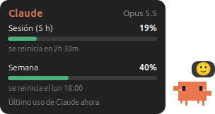

# Claude meter



Widget pequeño para Linux que se queda **siempre encima** de las demás ventanas. En reposo solo se ve el muñequito, sin fondo, con un globito con una **carita que cambia según tu consumo** (😄 → 😊 → 🙂 → 😐 → 😓 → 😫 → 😵, y 😴 si te fuiste); **al pasar el mouse** aparece cuánto llevas usado de tu plan de Claude:

- **Sesión (5 h)** y **Semana**: porcentaje usado, barra (verde → ámbar desde 60 % → rojo desde 85 %) y cuándo se reinicia
- el **muñequito pixelado de Claude Code**, animado, que cambia de ánimo según el uso: feliz saltando y saludando con poco (< 50 %), tranquila (< 75 %), cansada (< 90 %), triste con lagrimita (< 100 %) y agotada al llegar al límite, con la hora en que vuelve
- **mientras Claude trabaja** el muñeco teclea ("Trabajando…") y **cuando te pregunta algo o pide permiso** se rasca la cabeza con un signo de pregunta ("Tengo una duda…")
- **comenta lo que haces**, como si te viera: cuando cambias de programa ("¡A programar! 💻", "Modo hacker activado 😎"), cuando cambia la canción en Spotify ("🎵 Buen tema: …"), cuando te vas ("Zzz… te espero", se duerme) y cuando vuelves ("¡Volviste! 👋"); si llevas 50 min seguidos te sugiere una pausa, y avisa al cruzar 50/75/90 % de la sesión
- además, cada 2,5–5 min suelta una frase de **motivación** ("Paso a paso se llega lejos", "Hecho es mejor que perfecto"), de **cuidado** ("¿Tomaste agua? 💧") o una **pregunta** ("¿Cuál es la meta de hoy?"); se apaga con clic derecho → *Que me hable cuando no lo uso*
- **cuando Claude termina una tarea** te felicita ("¡Listo! Buen trabajo 💪", "¡Misión cumplida!")
- **un clic** sobre el muñeco y reacciona ("¡Ey!", "¡Jaja, cosquillas!")
- modelo en uso y hace cuánto fue el último uso de Claude Code (se pone ámbar pasada 1 hora)

Hecho con Python + GTK 3. Probado en Ubuntu 26.04 con GNOME (Wayland).

> Proyecto personal, no afiliado a Anthropic. El muñequito pixelado es la mascota de Claude Code.

## Cómo obtiene los datos

Los porcentajes del plan solo los conoce [Claude Code](https://docs.claude.com/en/docs/claude-code). Este repo trae una
**status line** (`statusline.py`) que Claude Code ejecuta en cada respuesta: recibe el bloque `rate_limits`,
lo imprime abajo en la terminal (`Opus · 5h 17% · semana 31% · contexto 13%`) y lo guarda en
`~/.cache/claude-meter.json`. El widget solo lee ese archivo cada 5 s; no se conecta a nada ni usa credenciales.

Requiere una suscripción de Claude (Pro/Max/Team): con API key no hay límites de plan que mostrar.
Los números se actualizan solo cuando Claude Code responde: si no lo usas, no cambian (es normal ver "hace 20 min").
El uso que hagas desde claude.ai o el móvil aparece recién en la siguiente respuesta de Claude Code.
Cuando una ventana pasa su hora de reinicio, el widget la muestra en 0 %.

### Actividad (teclea / duda)

`activity.py` es un *hook* de Claude Code que se registra en `UserPromptSubmit`, `PreToolUse`, `PostToolUse`,
`PermissionRequest`, `Notification`, `Stop` y `SessionEnd`. Anota por sesión si Claude está trabajando, esperando
tu respuesta (`AskUserQuestion`, `ExitPlanMode`, pedidos de permiso) o libre, en `~/.cache/claude-meter-activity.json`.
No imprime nada ni bloquea. Si hay varias sesiones, una pregunta pendiente en cualquiera gana.
Igual que la status line, acepta `CLAUDE_METER_ACTIVITY` y `CLAUDE_METER_OWNER`.

### Qué "ve" el muñeco

Todo es local y nada sale de tu equipo:

- **Si estás o te fuiste:** segundos sin teclado ni mouse, que da GNOME (`org.gnome.Mutter.IdleMonitor`).
- **Qué suena:** Spotify por MPRIS.
- **Qué programa usas (opcional):** en Wayland ninguna app puede saberlo por su cuenta, así que el repo trae una
  extensión mínima de GNOME (`gnome-extension/`) que solo entrega la *clase* de la ventana enfocada (`code`,
  `firefox`…), nunca títulos ni contenido. El instalador la copia pero **no la activa**: cierra y abre sesión y
  actívala en la app *Extensiones*. Sin ella, todo lo demás funciona igual.

## Requisitos

```bash
sudo apt install python3-gi gir1.2-gtk-3.0
```

## Instalar

```bash
git clone https://github.com/D4rksit3/claude-meter.git
cd claude-meter
./install.sh              # o ./install.sh --autostart para que arranque al iniciar sesión
```

El instalador agrega la `statusLine` a `~/.claude/settings.json` (con copia `.bak`). Si ya tienes una, no la toca
y te muestra la línea para ponerla a mano. Para quitarlo: `./uninstall.sh`.

### Si Claude Code corre como otro usuario

Por ejemplo, si lo usas como `root` y el widget corre con tu usuario, indica dónde escribir y de quién es el archivo:

```json
"statusLine": {
  "type": "command",
  "command": "CLAUDE_METER_OUT=/home/TU_USUARIO/.cache/claude-meter.json CLAUDE_METER_OWNER=1000:1000 python3 /root/.claude/claude-meter-statusline.py"
}
```

## Uso

- **Mover:** arrastra con clic izquierdo (recuerda la posición). Un clic sin arrastrar es un "toque".
- **Esquina:** clic derecho → *Llevar a la esquina*.
- **Cerrar:** clic derecho → *Cerrar medidor*. Se vuelve a abrir desde el menú de aplicaciones.

## Ver también

[spotify-mini-widget](https://github.com/D4rksit3/spotify-mini-widget), el mismo estilo para Spotify.

## Licencia

MIT
